# Kubernetes 기반 Hadoop Single Node HDFS 실습 보고서

## 과제 개요

본 실습은 Kubernetes 환경에서 Hadoop Single Node HDFS를 실행하고, HDFS Web UI와 HDFS 명령어를 통해 데이터 저장 과정을 확인하는 것을 목표로 한다. 실습에서는 kind 기반 Kubernetes 클러스터를 생성한 뒤 YAML 파일로 Hadoop Single Node Deployment와 Service를 구성했다. 이후 Service port-forwarding으로 HDFS Web UI에 접속하고, Pod 내부 namenode 컨테이너에서 HDFS 명령어를 실행해 샘플 파일 저장 여부를 확인했다.

## 과제 요구사항

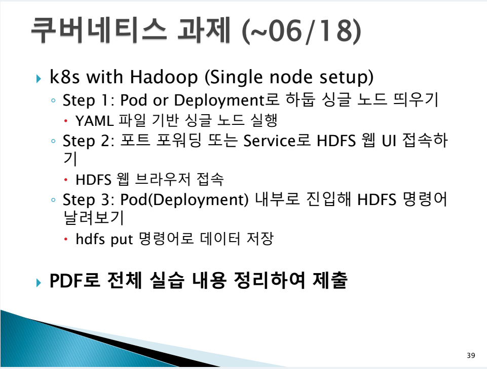

- Kubernetes에서 Hadoop Single Node를 Pod 또는 Deployment로 실행한다.
- YAML 파일 기반으로 Hadoop Single Node를 실행한다.
- Port-forwarding 또는 Service로 HDFS Web UI에 접속한다.
- Pod 또는 Deployment 내부로 진입해 HDFS 명령어를 실행한다.
- `hdfs put` 또는 `hdfs dfs -put` 명령어로 데이터를 저장한다.
- 전체 실습 내용을 PDF로 정리해 제출한다.

## 실습 환경

| 항목 | 내용 |
| --- | --- |
| 클러스터 구성 도구 | kind |
| Kubernetes 노드 | `hadoop-lab-control-plane` |
| Kubernetes 버전 | `v1.24.17` |
| 노드 OS 이미지 | Debian GNU/Linux 12 (bookworm) |
| 실행 방식 | Deployment |
| Hadoop Deployment | `hadoop-single-node` |
| Hadoop Pod | `hadoop-single-node-b584c4554-v7hvc` |
| Hadoop Service | `hadoop-hdfs-ui` |
| Service 포트 | `9870/TCP`, `8020/TCP` |
| Web UI 접속 주소 | `http://192.168.0.100:9870` |

## Step 1: Hadoop Single Node 실행

kind 기반 Kubernetes 클러스터를 생성한 뒤 `kubectl get nodes -o wide`와 `kubectl get pods -A`로 클러스터 상태를 확인했다. 초기 확인 후 시스템 Pod가 정상화될 때까지 대기했고, 최종적으로 control-plane 노드와 kube-system Pod들이 `Ready` 또는 `Running` 상태로 확인되었다.

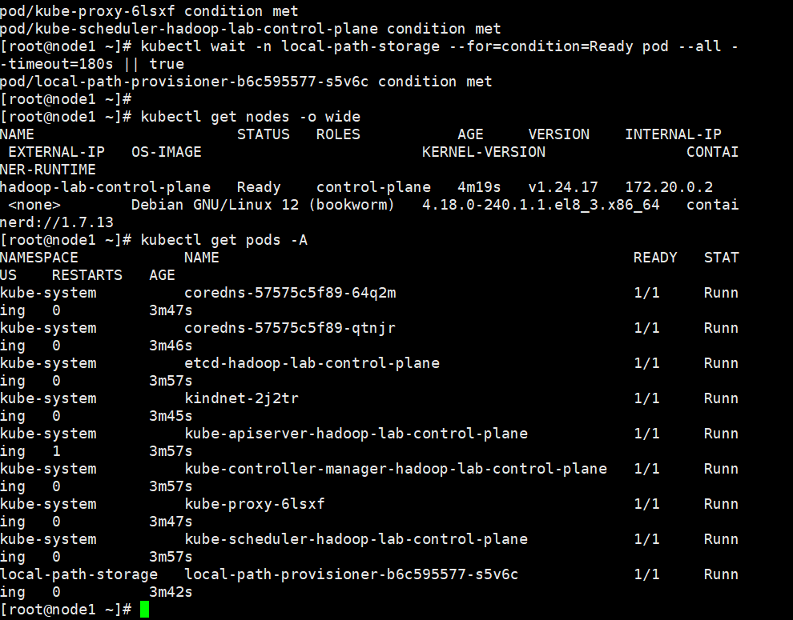

Hadoop Single Node 실행을 위해 `hadoop-single-node.yaml` 파일을 작성했다. YAML은 `hadoop-single-node` Deployment와 `hadoop-hdfs-ui` Service로 구성했고, Deployment 내부에는 namenode와 datanode 컨테이너를 함께 배치했다. namenode Web UI 포트는 `9870`, HDFS RPC 포트는 `8020`으로 설정했다.

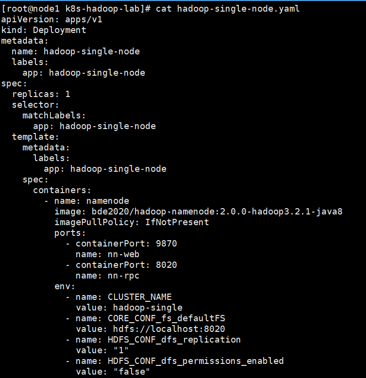

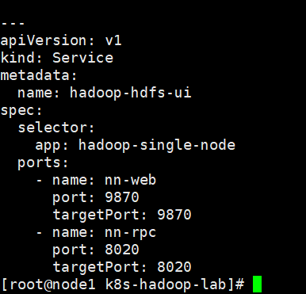

### 실행 명령어

```bash
kubectl get nodes -o wide
kubectl get pods -A
kubectl apply -f hadoop-single-node.yaml
kubectl get pods -o wide
kubectl get deployment
kubectl get svc
```

### 실행 결과

```text
deployment.apps/hadoop-single-node created
service/hadoop-hdfs-ui created
```

`kubectl get pods -o wide` 결과 Hadoop Pod는 `2/2 Running` 상태로 실행되었고, Deployment는 `1/1`로 준비되었다. Service `hadoop-hdfs-ui`는 ClusterIP 타입으로 생성되었으며 `9870/TCP`, `8020/TCP` 포트를 제공했다.

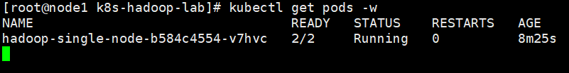

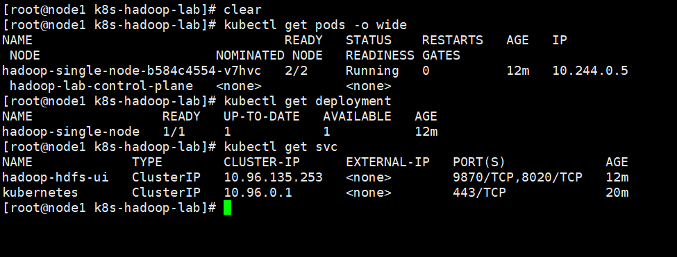

## Step 2: HDFS Web UI 접속

HDFS Web UI 접속을 위해 `hadoop-hdfs-ui` Service를 대상으로 port-forwarding을 실행했다. 외부 브라우저에서 VM의 IP 주소로 접속하기 위해 `--address 0.0.0.0` 옵션을 사용했고, 로컬 포트 `9870`을 Service의 `9870` 포트로 전달했다.

### 실행 명령어

```bash
kubectl port-forward --address 0.0.0.0 svc/hadoop-hdfs-ui 9870:9870
```

### 실행 결과

```text
Forwarding from 0.0.0.0:9870 -> 9870
Handling connection for 9870
```

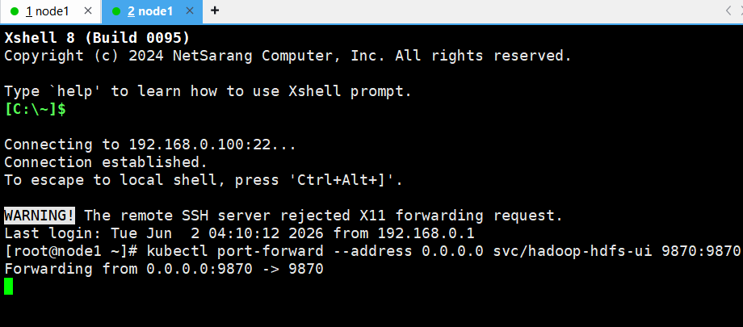

브라우저에서는 `http://192.168.0.100:9870` 주소로 접속했고, HDFS 파일 브라우저 경로 `/explorer.html#/` 화면을 확인했다. 초기 루트 디렉터리 조회 화면에서는 파일이 없는 상태로 표시되었다.

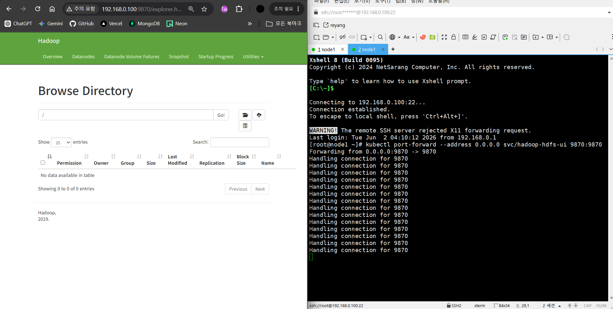

## Step 3: HDFS 명령어 실행 및 데이터 저장

Hadoop Pod 내부 namenode 컨테이너에 접속해 HDFS 명령어를 실행했다. `/tmp/sample.txt` 파일에 `Hello Hadoop on Kubernetes` 문자열을 작성한 뒤, HDFS의 `/user/root/input` 경로를 생성하고 `hdfs dfs -put` 명령어로 샘플 파일을 저장했다.

### 실행 명령어

```bash
kubectl exec -it hadoop-single-node-b584c4554-v7hvc -c namenode -- bash

printf "Hello Hadoop on Kubernetes\n" > /tmp/sample.txt
cat /tmp/sample.txt
hdfs dfs -mkdir -p /user/root/input
hdfs dfs -put -f /tmp/sample.txt /user/root/input/sample.txt
hdfs dfs -ls -R /user/root
hdfs dfs -du -h /user/root/input/sample.txt
```

### 실행 결과

```text
Hello Hadoop on Kubernetes

drwxr-xr-x   - root supergroup          0 2026-06-02 05:30 /user/root/input
-rw-r--r--   1 root supergroup         27 2026-06-02 05:30 /user/root/input/sample.txt

27  27  /user/root/input/sample.txt
```

업로드 전 원본 파일의 내용은 `Hello Hadoop on Kubernetes`로 확인되었다. `hdfs dfs -ls -R /user/root` 결과 `/user/root/input/sample.txt` 파일이 생성된 것을 확인했다. `hdfs dfs -du -h /user/root/input/sample.txt` 결과 파일 크기는 `27`로 표시되었다.

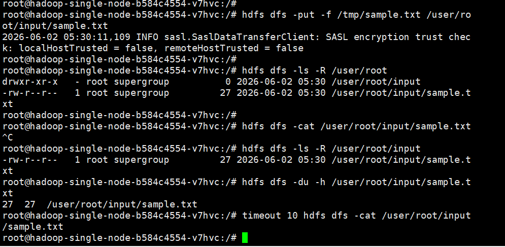

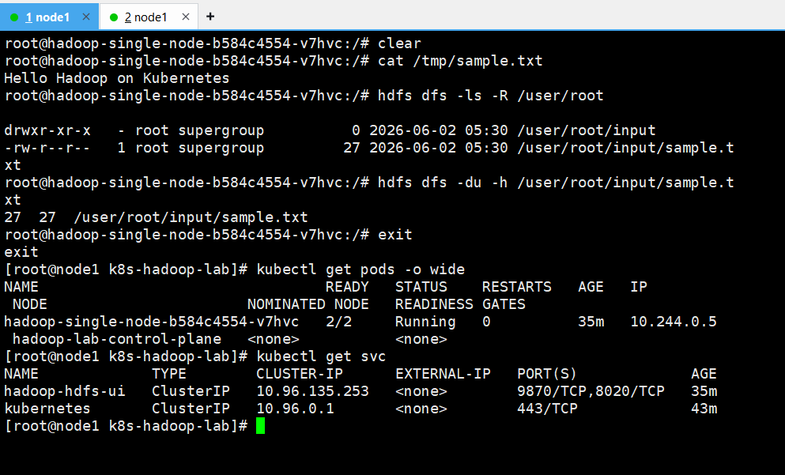

HDFS Web UI에서도 `/user/root/input` 경로에 `sample.txt` 파일이 표시되었다. Web UI 화면에서는 파일 소유자 `root`, 그룹 `supergroup`, 크기 `27 B`, replication `1`이 함께 확인되었다.

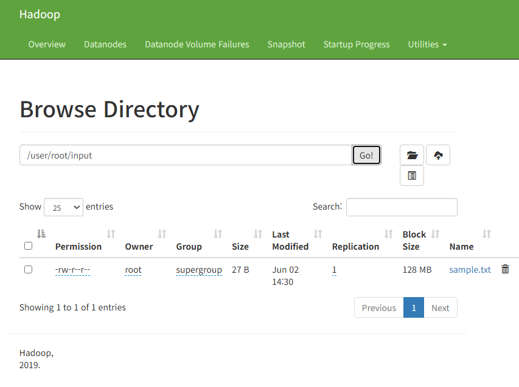

## 실행 결과 정리

| 구분 | 결과 |
| --- | --- |
| Kubernetes 클러스터 | kind 기반 `hadoop-lab-control-plane` 노드가 `Ready` 상태로 동작 |
| Hadoop 실행 방식 | YAML 기반 Deployment로 Hadoop Single Node 실행 |
| Pod 상태 | `hadoop-single-node-b584c4554-v7hvc` Pod가 `2/2 Running` 상태 |
| Deployment 상태 | `hadoop-single-node` Deployment가 `1/1` 상태 |
| Service 상태 | `hadoop-hdfs-ui` Service에서 `9870/TCP`, `8020/TCP` 제공 |
| Web UI 접속 | `http://192.168.0.100:9870` 및 `/explorer.html#/` 접속 확인 |
| HDFS 데이터 저장 | `/user/root/input/sample.txt` 저장 확인 |
| 업로드 원본 파일 내용 | `Hello Hadoop on Kubernetes` |
| 저장 파일 크기 | `27 B` |

## 결론

Kubernetes 위에서 Hadoop Single Node HDFS를 Deployment와 Service로 실행했고, port-forwarding을 통해 HDFS Web UI에 접속했다. 또한 Pod 내부 namenode 컨테이너에서 HDFS 명령어를 실행해 `/user/root/input/sample.txt` 파일을 저장했으며, CLI 조회 결과와 HDFS Web UI 화면을 통해 데이터 저장이 정상적으로 이루어진 것을 확인했다.
